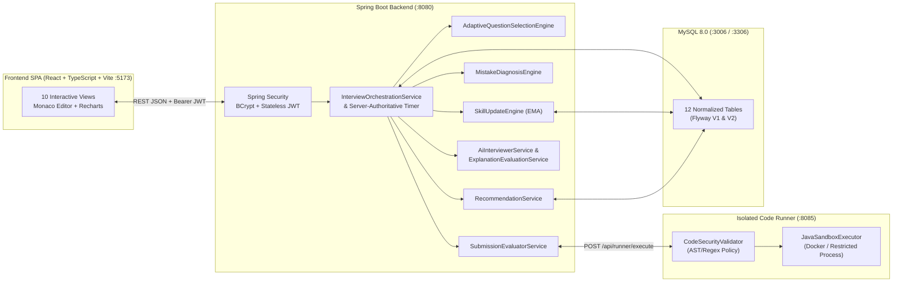

# Architecture & Technical Design — Adaptive Technical Interview Simulator

## 1. System Architecture Overview

---

## 2. Continuous Skill Profile & Mathematical Update Formula

Each candidate has five persisted competency rows in `user_skill_profiles`:
- `PATTERN_RECOGNITION`
- `IMPLEMENTATION`
- `COMPLEXITY_ANALYSIS`
- `DEBUGGING`
- `COMMUNICATION`

When a new assessment rating $r \in [0, 100]$ with confidence $c \in [0, 1]$ is recorded against a prior skill score $s \in [0, 100]$, `SkillUpdateEngine` applies an exponentially weighted moving average (EMA) scaled by the assessment's confidence:

$$\alpha_{\text{eff}} = \text{clamp}(\alpha_{\text{base}} \cdot (0.5 + 0.5 \cdot c),\; 0.10,\; 0.55)$$

$$s_{\text{new}} = \text{clamp}\!\left(\alpha_{\text{eff}} \cdot r + (1 - \alpha_{\text{eff}}) \cdot s,\; 0.0,\; 100.0\right)$$

where $\alpha_{\text{base}} = 0.35$. Every update writes an immutable audit row to `skill_assessments` containing `previous_score`, `assessed_score`, `new_score`, `confidence`, `evidence_json`, and `source_type` (`EXECUTION_ENGINE`, `LIVE_LLM`, or `FALLBACK_RUBRIC`).

---

## 3. Evidence-Grounded Mistake Diagnosis Engine

`MistakeDiagnosisEngine` strictly separates **observed facts** from **inferred hypotheses** so the platform never states unverified speculation as fact:

| Competency | Observed Facts (Deterministic Telemetry) | Inferred Hypothesis (Confidence-Thresholded) |
| :--- | :--- | :--- |
| **Implementation** | Compilation status, compiler error line numbers, sample vs hidden test pass count, runtime exceptions (`NullPointerException`, `IndexOutOfBoundsException`) | Boundary/off-by-one oversight on hidden edge cases when sample tests pass ($100\%$) but hidden tests fail |
| **Pattern Recognition** | Timeout (`TIME_LIMIT_EXCEEDED`), runtime scaling across large hidden inputs, presence/absence of expected data structure keywords | Brute-force nested iteration used where hash-map, two-pointer, or dynamic programming state transition is required |
| **Debugging** | Sequence of `CODE_RUN` and `CODE_SUBMITTED` events, transition from failing tests to passing tests, number of hints requested | Systematic fault isolation vs trial-and-error edits without reproducing failing inputs |
| **Complexity Analysis** | Candidate's submitted time and space complexity strings compared against canonical complexity + explanation trade-off analysis | Confusion between auxiliary heap allocation and in-place mutation |
| **Communication** | Structured rubric evaluation of algorithm walkthrough, invariant explanation, and edge-case articulation | Incomplete explanation of why the algorithm terminates or maintains correctness |

---

## 4. Adaptive Question Selection Engine

`AdaptiveQuestionSelectionEngine` selects the next question dynamically after each question in an interview session:

1. **Topic & Type Filtering**: Filters candidate questions matching the session's configured topics and excludes any question already asked in the current session or recently solved by the user.
2. **Difficulty Calibration**:
   - If the candidate passed all sample and hidden tests on the previous question with $\le 1$ hint and strong explanation score ($\ge 75$), difficulty steps up (`EASY` $\to$ `MEDIUM` $\to$ `HARD`).
   - If the candidate struggled ($< 50\%$ tests passed or $\ge 3$ hints used), difficulty steps down or stays supportive to rebuild momentum and isolate the bottleneck.
3. **Weakness Targeting**: Identifies the user's lowest-scoring competency from `user_skill_profiles` (and any bottleneck diagnosed on the previous question) and scores candidate questions by alignment with that target competency.
4. **Transparent Selection Rationale**: Persists a human-readable `selection_reason` and `target_competency` on `interview_questions`, displayed both in the live workspace and in the final interview report.

---

## 5. Code Execution Isolation & Security Boundaries

Candidate Java code is never compiled or executed inside the main API JVM. Instead, `backend` sends execution requests over HTTP to `runner-service` (`port 8085`):

1. **Static Security Policy (`CodeSecurityValidator`)**:
   - Rejects code exceeding size limits or declaring custom `package` statements.
   - Blocks forbidden APIs before compilation: `java.io.File`, `java.nio.file`, `java.net.*`, `ProcessBuilder`, `Runtime.getRuntime()`, `System.exit`, `java.lang.reflect`, `ClassLoader`, `Thread.sleep`, and native JNI calls.
2. **Execution Modes (`JavaSandboxExecutor`)**:
   - `DOCKER_CONTAINER` (when Docker daemon is active): Runs `javac` and `java` inside an ephemeral container with `--network none`, `--memory 128m`, `--cpus 0.5`, `--pids-limit 32`, and read-only root filesystem.
   - `RESTRICTED_LOCAL_SANDBOX` (automatic fallback when Docker daemon is unavailable): Compiles and runs inside an isolated per-attempt temporary directory with `-Xmx128m -XX:ActiveProcessorCount=1`, strict per-test wall-clock timeout (`4000ms`), `ProcessHandle.descendants()` process-tree kill on timeout, stdout/stderr truncation (`8192` chars), and immediate directory cleanup.
3. **Zero Leakage of Hidden Tests**:
   - `QuestionService` and `SubmissionEvaluatorService` strip hidden test inputs and expected outputs from `SampleOnly` runs and mask hidden test payloads in submission summaries so candidates cannot harvest hidden test cases.
